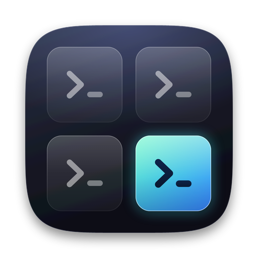
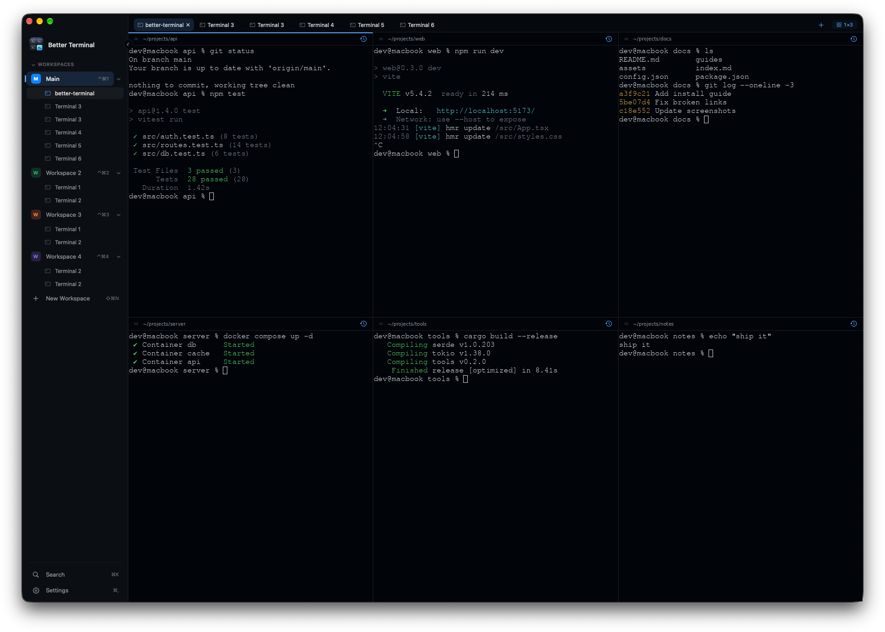
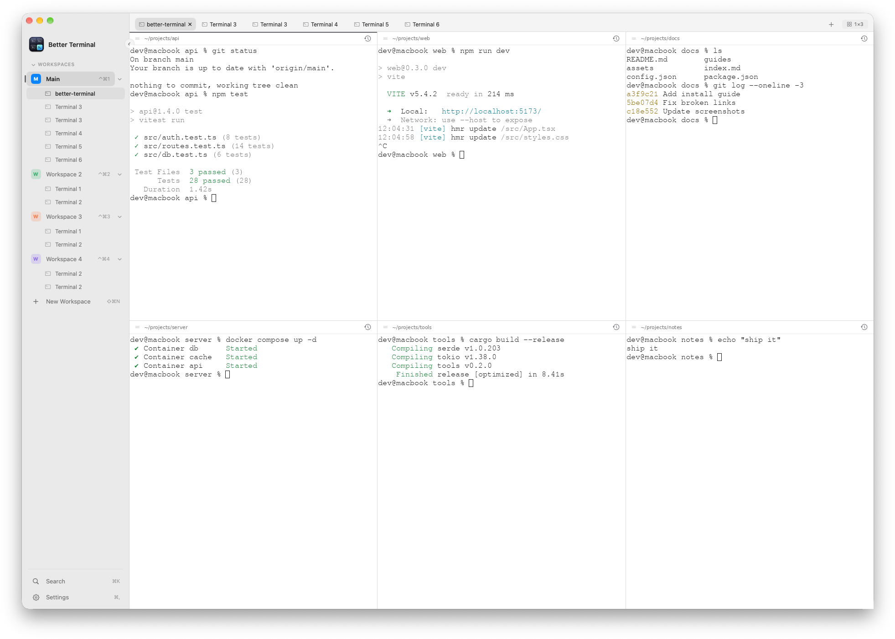

<p align="center">
  
</p>

<h1 align="center">Better Terminal</h1>

<p align="center">
  A fast, native macOS terminal with workspaces, pane layouts and per-tab history,<br>
  that remembers where you left off.
</p>

<p align="center">
  <a href="https://github.com/mohitkap12-a11y/Better-Terminal/releases/latest/download/BetterTerminal.dmg"><b>Download for macOS</b></a> ·
  <a href="https://mohitkap12-a11y.github.io/Better-Terminal/">Website</a> ·
  <a href="https://github.com/mohitkap12-a11y/Better-Terminal/releases">Releases</a>
</p>

<p align="center">
  <a href="https://github.com/mohitkap12-a11y/Better-Terminal/actions/workflows/ci.yml"></a>
  
  
  <a href="LICENSE"></a>
</p>

<p align="center">
  
</p>
<p align="center">
  
</p>

<p align="center"><a href="https://mohitkap12-a11y.github.io/Better-Terminal/docs/"><b>Read the documentation →</b></a></p>

## Features

- **Workspaces.** One per project, each with its own tabs, layout and folders. Switch from the sidebar or with `⌃⌘1–9`.
- **Collapsible sidebar.** Fold the whole workspace list, or each workspace's tabs; the sidebar remembers it.
- **Drag to organise.** Reorder workspaces and tabs by dragging them in the sidebar, drop a tab on a workspace to move it, right-click a tab to rename it or move it to another workspace.
- **Pane layouts.** Tabs fill a grid: 1×2, 2×1, 2×2 or any custom rows × columns. New tabs follow the layout, and the grid shrinks to fit when you have fewer tabs than slots.
- **Split panes.** `⌘D` splits right, `⇧⌘D` splits down. Drag a pane header onto another pane to swap them.
- **Workspace templates.** Save a layout, folders and startup commands; open the whole setup in one click.
- **History for every tab.** Click the clock (or `⇧⌘H`), type to search, `↑↓` to move, `⏎` to insert, `⌘⏎` to run. Right-click a command to copy it or run it again.
- **Move between panes.** `⌘` + arrow keys jump to the neighbouring terminal; the pane you land on pulses.
- **Resume on relaunch.** Quit and reopen: workspaces, tabs, layouts, folders, history and the text on screen come back. A fresh shell starts below it (running programs can't be revived). Switch it off in Settings if you handle secrets.
- **Command palette.** `⌘K` for actions. Press `→` for the last 30 commands from every terminal, searchable, and `→` again for your saved commands, which run in whichever terminal has focus.
- **Find in terminal.** `⌘F` with highlighted matches; `⌘G` / `⇧⌘G` to step through them.
- **Tab status and notifications.** A spinner while a command runs, a red dot when one failed, and a notification when a long command finishes in another tab.
- **Broadcast input.** `⌥⌘B` repeats your typing in every pane of the workspace.
- **Quick terminal.** A global key (`⌃`` by default) pops up a small terminal in the bottom-right corner, in the folder you were in. `Esc` hides it.
- **Right-click menu and links.** Copy, paste, open link, find, split; links underline on hover. `⌥⌘C` copies the last command's output.
- **Soft colour themes.** Default, Mist, Sage, Rose, Lavender, Sand, Nord, Black, in light and dark. System follows macOS. Import iTerm2, Ghostty and kitty themes, and pick any monospaced font.
- **Updates built in** ([Sparkle](https://sparkle-project.org)), Stable by default or Beta in Settings.
- **Private.** No account and no telemetry; the only network call is the update check.

## Install

**Homebrew**

```bash
brew install --cask mohitkap12-a11y/better-terminal/better-terminal
```

**Or manually**

1. Download the DMG from the [latest release](https://github.com/mohitkap12-a11y/Better-Terminal/releases/latest).
2. Drag **Better Terminal** to Applications.

Requires macOS 14 Sonoma or later. Apple silicon and Intel.

## Keyboard shortcuts

| Action | Keys |
| --- | --- |
| New tab / close tab | `⌘T` / `⌘W` |
| New workspace | `⇧⌘N` |
| Switch workspace | `⌃⌘1`–`⌃⌘9` |
| Close a tab / rename a tab | middle-click / double-click |
| Move between panes | `⌘←` `⌘→` `⌘↑` `⌘↓` |
| Split right / down | `⌘D` / `⇧⌘D` |
| Pane layout | `⌥⌘L` |
| Broadcast to all panes | `⌥⌘B` |
| Swap two panes | drag a pane header onto another |
| Command palette (→ for Commands) | `⌘K` |
| Command history | `⇧⌘H` (⏎ insert, ⌘⏎ run) |
| Find / next / previous | `⌘F` / `⌘G` / `⇧⌘G` |
| Copy last command output | `⌥⌘C` |
| Bigger / smaller text | `⌘+` / `⌘−` |
| Quick terminal | `⌃`` (changeable in Settings) |
| Keyboard shortcuts popup (⏎ runs one) | `⌘/` |
| Toggle the sidebar | `⌃⌘S` |
| Settings | `⌘,` |

## Your data

Everything lives in `~/Library/Application Support/BetterTerminal`: `state.json` (workspaces, tabs, layouts, settings), `history/` (commands per tab), `snapshots/` (terminal text for resume). Settings → Terminal has a switch for resume and a Clear button.

## Build from source

Needs macOS 14+, Xcode 15+ and [XcodeGen](https://github.com/yonaskolb/XcodeGen).

```bash
brew install xcodegen
git clone https://github.com/mohitkap12-a11y/Better-Terminal.git
cd Better-Terminal
xcodegen generate
open BetterTerminal.xcodeproj      # run the BetterTerminal scheme
swift test                         # tests for the core logic
```

The terminal view is [SwiftTerm](https://github.com/migueldeicaza/SwiftTerm), behind a small protocol so another engine (libghostty) can replace it. See [ARCHITECTURE.md](ARCHITECTURE.md) for how the pieces fit and [DESIGN.md](DESIGN.md) for the UI rules.

## Releasing

Tag-driven: `v1.2.3` is a stable release, `v1.2.3-beta.1` goes to the Beta channel, `v1.2.3-rc1` is a dry run. Signing, notarization, the DMG and the Sparkle feed are automated. See [docs/release.md](docs/release.md).

## Website

The site in [`site/`](site) is plain HTML and CSS, deployed to GitHub Pages by `.github/workflows/pages.yml`. The hero shows the real screenshots in `site/assets/screenshots/`.

To make new screenshots, capture the whole window on a Mac (`scripts/screenshot.sh dark` and `light`, or any capture), then run `python3 scripts/redact-screenshots.py dark in.png site/assets/screenshots/app-dark.png` (and `light`). It replaces the text in the six panes and the folder paths in the pane headers with generic sample content, so no real names or paths are published. Copy the results to `docs/images/` for this README.

### Documentation

The docs are Markdown in [`docs/site-src`](docs/site-src). After editing, run `node scripts/build-docs.js` to regenerate `site/docs/*.html` and commit both.

## Support

Better Terminal is free and open source. If it saves you time you can [sponsor it on GitHub](https://github.com/sponsors/mohitkap12-a11y), [donate with PayPal](https://paypal.me/mkapoor91) or just star the repo. It is all optional; see the [support page](https://mohitkap12-a11y.github.io/Better-Terminal/support.html) or Settings → Support in the app.

## License

[MIT](LICENSE), copyright (c) 2026 Mohit Kapoor. Third-party components and their licenses are listed in [THIRD_PARTY_NOTICES.md](THIRD_PARTY_NOTICES.md).
